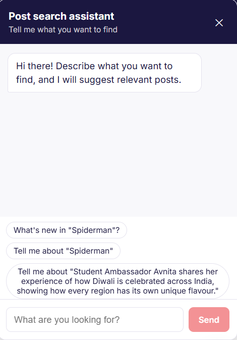
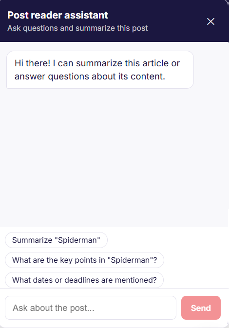

# University Blog

A university community publishing platform where students and teachers can share updates, opportunities, and knowledge. Posts go through administrator review before publication, and readers can browse by topic, discuss posts, and use AI tools to find or understand content.

## Features

- **Published post discovery:** Browse, search, and filter published posts by curated tags. Post pages include author and date information, images, and sharing links.
- **Post submissions and moderation:** Authenticated users can create posts with cover/inline images and administrator-curated tags. Submissions are pending until an administrator approves them.
- **Author post management:** Authors can edit or delete their own posts. Editing a post sends it back for administrator approval.
- **Comments:** Authenticated users can comment on published posts. Comment authors can delete their own comments; administrators can delete any comment.
- **AI reading assistant:** Ask questions about a post or request a summary based on the post content.
- **AI post discovery:** Describe what you are looking for and receive links to relevant published posts. Recommendations include post dates, prioritize recency for time-sensitive requests, and avoid repeating posts already recommended in the current chat.
- **Dynamic chat prompts:** Home prompts are generated from currently published post titles and tags. Post-detail prompts are based on that post's title, tags, and content.
- **Account management:** Email OTP registration, JWT login, Google sign-in, user role management, and administrator account deactivation/reactivation.
- **Curated tags:** Administrators manage the tag list; authors choose from it rather than submitting free-form tags.
- **Image uploads:** Supports JPEG, PNG, GIF, and WebP images with file type and size validation.

## Screenshots

The chat prompt text shown below is illustrative; prompt suggestions are generated from current published posts in the running application.

| Home page chat prompts | Post detail chat prompts |
|---|---|
|  |  |

## Tech stack

**Frontend**
- React 19
- React Router
- Vite
- Axios

**Backend**
- Java 25
- Spring Boot 4
- Spring MVC, Spring Security, Spring Data JPA, Bean Validation
- JWT authentication
- MySQL
- Google Gemini API for AI features

## Prerequisites

- Java 25
- Node.js and npm
- MySQL
- API credentials for the optional integrations you plan to use (Google sign-in, email, and Gemini)

## Setup

1. **Create the database.** The default backend JDBC URL targets `localhost:3306/university_blog_db`. Update the datasource URL, username, and password in `backend/src/main/resources/application.properties` to match your local MySQL setup. Hibernate is configured to update the schema on startup.

2. **Configure environment variables** used by the backend:

   | Variable | Used for |
   |---|---|
   | `JWT_SECRET` | Signing JWT tokens; use a long, random secret |
   | `GOOGLE_CLIENT_ID` | Google sign-in |
   | `FACEBOOK_APP_ID` | Facebook integration configuration |
   | `FACEBOOK_APP_SECRET` | Facebook integration configuration |
   | `MAIL_USERNAME` | SMTP account used for verification email |
   | `MAIL_PASSWORD` | SMTP account password or app password |
   | `GEMINI_API_KEY` | Gemini AI requests |
   | `APP_UPLOAD_DIR` | Optional upload directory; defaults to `uploads` |

   Supply real credentials through your shell or a local, untracked environment file. Do not commit credentials or production secrets. If an integration is not configured, its related feature may not work.

3. **Start the backend** from the repository root:

   ```powershell
   cd backend
   .\mvnw.cmd spring-boot:run
   ```

   On macOS/Linux, run `./mvnw spring-boot:run` from `backend`.

4. **Install frontend dependencies and start the frontend** in another terminal:

   ```powershell
   cd frontend
   npm install
   npm run dev
   ```

   Vite prints the local URL when the development server starts (typically `http://localhost:5173`). To point the frontend at a different backend, set `VITE_API_URL` to the backend base URL; the application appends `/api`.

5. **Build or lint the frontend** from `frontend`:

   ```sh
   npm run build
   npm run lint
   ```

## Docker setup

You can run the full stack in containers with Docker Compose. This starts the MySQL database, the Spring Boot backend, and a production Nginx build of the React frontend.

1. Copy the example environment file and adjust any values you need:

   ```powershell
   Copy-Item .env.example .env
   ```

2. Start the stack:

   ```powershell
   docker compose up --build
   ```

3. Open the app in a browser:

   - Frontend: `http://localhost:5173`
   - Backend API: `http://localhost:8080`

4. Stop the stack with:

   ```powershell
   docker compose down
   ```

   To also remove persisted database data, use `docker compose down -v`.

## Main API endpoints

All endpoints are relative to `/api`. Protected endpoints require `Authorization: Bearer <JWT>`. Admin endpoints require the administrator role.

| Method | Endpoint | Access | Purpose |
|---|---|---|---|
| `POST` | `/auth/register` | Public | Start email-verified registration |
| `POST` | `/auth/verify-otp` | Public | Verify registration code and sign in |
| `POST` | `/auth/resend-otp` | Public | Resend a verification code |
| `POST` | `/auth/login` | Public | Sign in and receive a JWT |
| `POST` | `/auth/google` | Public | Sign in with Google |
| `GET` | `/posts` | Public | List approved posts |
| `GET` | `/posts/{id}` | Public for approved posts | Get a post |
| `POST` | `/posts` | Authenticated | Submit a post (`multipart/form-data`) |
| `GET` | `/posts/mine` | Authenticated | List the signed-in user's posts |
| `GET` | `/posts/{id}/edit` | Post owner | Get owned post data for editing |
| `PUT` | `/posts/{id}` | Post owner | Edit a post and resubmit it for review |
| `DELETE` | `/posts/{id}` | Post owner or admin | Delete a post |
| `GET` | `/posts/{postId}/comments` | Public for approved posts | List comments |
| `POST` | `/posts/{postId}/comments` | Authenticated | Add a comment |
| `DELETE` | `/comments/{commentId}` | Comment owner or admin | Delete a comment |
| `GET` | `/tags` | Authenticated | List curated tags |
| `POST` | `/tags` | Admin | Create a tag |
| `DELETE` | `/tags/{id}` | Admin | Delete a tag |
| `POST` | `/chat` | Authenticated | Ask the AI assistant or search for posts |
| `POST` | `/posts/{id}/summarize` | Authenticated | Generate a post summary |
| `GET` | `/admin/posts?status=PENDING` | Admin | List posts by moderation status |
| `PATCH` | `/admin/posts/{id}/approve` | Admin | Approve a post |
| `PATCH` | `/admin/posts/{id}/reject` | Admin | Reject a post |
| `GET` | `/admin/users` | Admin | List accounts |
| `PATCH` | `/admin/users/{id}/active` | Admin | Deactivate or reactivate an account |
| `PATCH` | `/admin/users/{id}/role` | Admin | Change a student/teacher role |

Post creation and editing use a `post` JSON multipart part, with optional `image` and `images` file parts. Comment requests use JSON, for example:

```json
{ "content": "Thanks for sharing this update." }
```

## Project layout

```text
backend/   Spring Boot REST API and persistence
frontend/  React web application
docs/      Project documentation and screenshots
```
